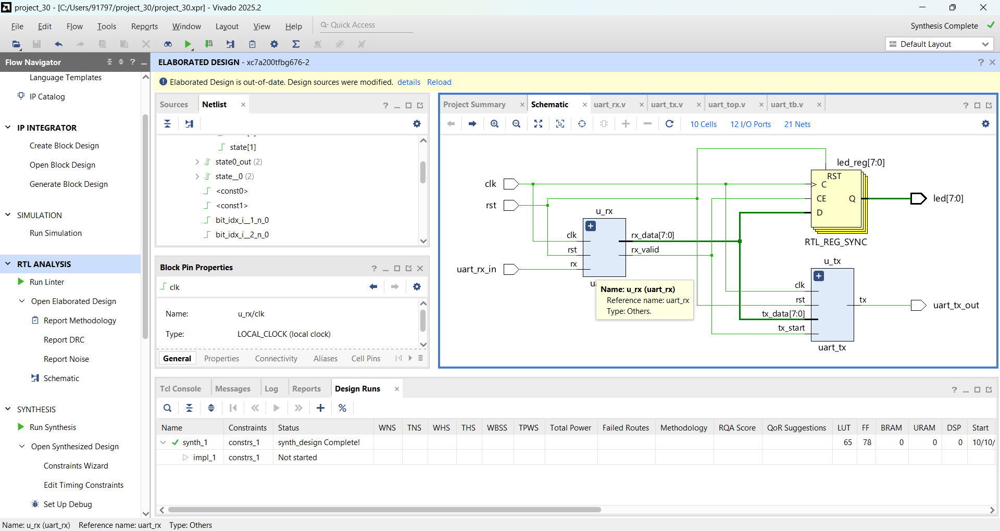
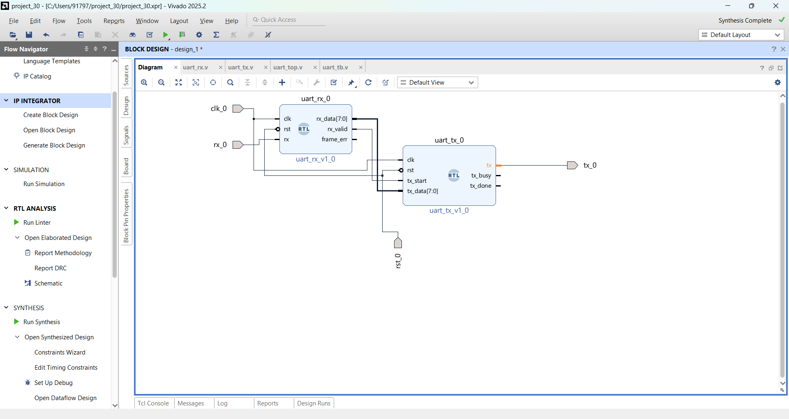
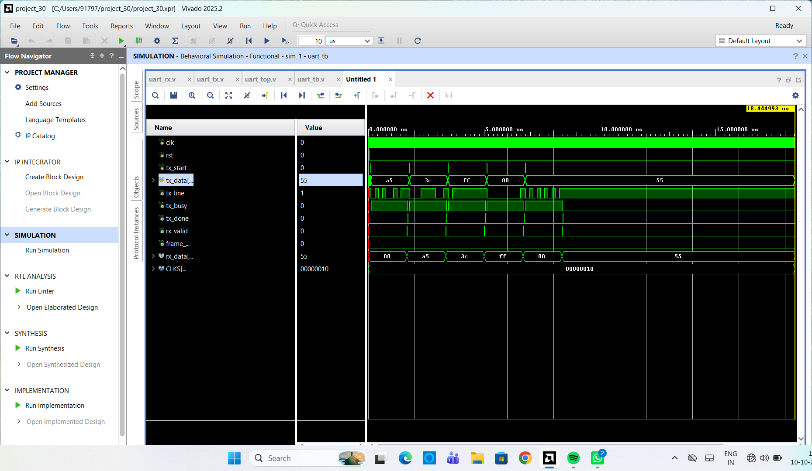
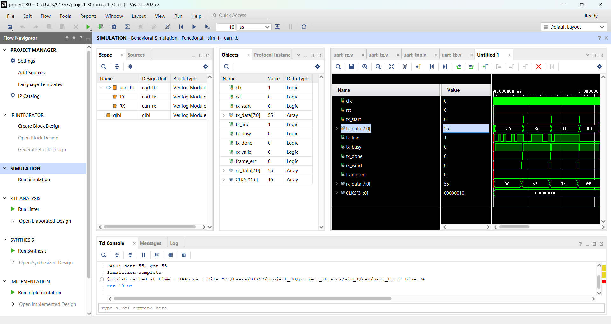
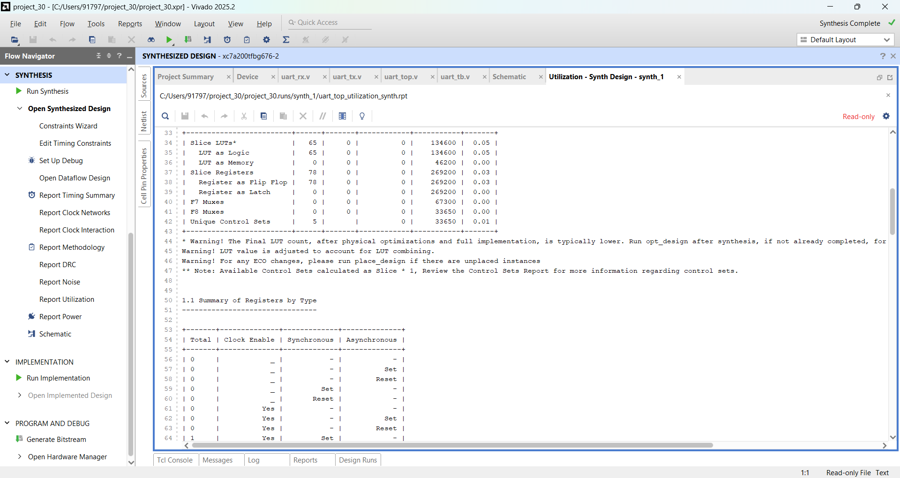
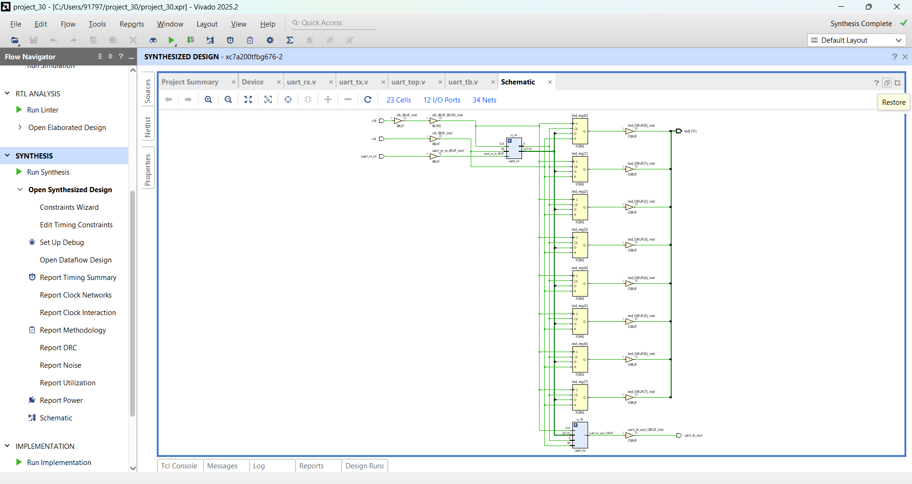

# UART Transmitter and Receiver in Verilog

UART (8N1) transmitter and receiver designed in Verilog, simulated and synthesized in Xilinx Vivado 2025.2.

## Specifications
- Frame: 1 start bit, 8 data bits, 1 stop bit, no parity
- Baud rate: 115200, clock: 100 MHz (CLKS_PER_BIT = 868)
- Receiver samples in the middle of each bit, with a 2-FF synchronizer

## Files
- uart_tx.v: transmitter (FSM: IDLE, START, DATA, STOP)
- uart_rx.v: receiver
- uart_top.v: top module (echo: received byte is sent back)
- uart_tb.v: testbench

## Results
- Simulation: bytes A5, 3C, FF, 00, 55 transmitted and received correctly, no framing errors
- Synthesis: 65 LUTs, 78 flip-flops, 0 latches

## How to run
Add all .v files to a Vivado project, set uart_tb as the simulation top, and run behavioral simulation.
## Block Diagram

## Simulation Waveform

## Simulation Console (PASS)

## Synthesis

## SystemVerilog Version

The same UART design re-implemented in SystemVerilog, in the [systemverilog](systemverilog/) folder.

- uart_tx.sv, uart_rx.sv, uart_top.sv: design using logic, typedef enum FSMs and always_ff
- uart_tb.sv: self-checking testbench with a queue-based scoreboard (5 directed + 10 random bytes)

### Results
- Simulation: 15 of 15 bytes passed, 0 failed, no framing errors (TEST PASSED)

